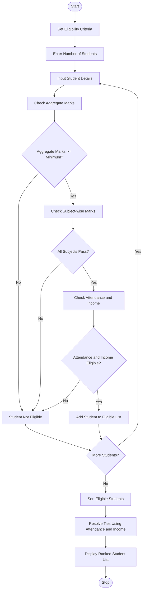

# University Scholarship Allocation System Using Python

## 1\. Problem Statement

The University Scholarship Allocation System is designed to evaluate and rank students based on predefined eligibility criteria.

The system considers the following factors:

1. **Aggregate Marks:** The student must obtain the minimum required aggregate percentage.
2. **Subject-wise Minimum Marks:** The student must score the minimum marks required in each subject.
3. **Attendance:** The student must meet the minimum attendance percentage.
4. **Family Income:** The student's annual family income must be within the specified limit.

The system identifies eligible students, ranks them based on their aggregate marks, and resolves ties using predefined rules.

**Tie-breaking rules:**

- First priority: Higher aggregate marks.
- Second priority: Higher attendance percentage.
- Third priority: Lower annual family income.

The system displays the list of eligible students in merit order.

## 2\. Algorithm

1. Start the program.
2. Define the minimum aggregate marks, subject-wise marks, attendance, and maximum family income.
3. Enter the number of students.
4. Input each student's:
   - Name
   - Aggregate marks
   - Subject-wise marks
   - Attendance percentage
   - Annual family income
5. Check whether the student satisfies all eligibility criteria.
6. If all conditions are satisfied, add the student to the eligible list.
7. Otherwise, mark the student as not eligible.
8. Sort eligible students based on:
   - Higher aggregate marks.
   - Higher attendance.
   - Lower family income.
9. Display the ranked list of eligible students.
10. Stop the program.

## 3\. Flowchart (Mermaid Code)

mermaid



## 4\. Python Source code

```python
# University Scholarship Allocation System

# Eligibility Criteria
MIN_AGGREGATE = 75
MIN_SUBJECT_MARKS = 40
MIN_ATTENDANCE = 75
MAX_INCOME = 300000

students = []
eligible_students = []

# Get number of students
n = int(input("Enter number of students: "))

# Input student details
for i in range(n):

    print("\nEnter details of Student", i + 1)

    name = input("Enter student name: ")

    aggregate = float(input("Enter aggregate marks: "))

    attendance = float(input("Enter attendance percentage: "))

    income = float(input("Enter annual family income: "))

    subjects = int(input("Enter number of subjects: "))

    marks = []

    for j in range(subjects):
        mark = float(input("Enter marks of subject " + str(j + 1) + ": "))
        marks.append(mark)

    # Check eligibility
    if (aggregate >= MIN_AGGREGATE and
        all(mark >= MIN_SUBJECT_MARKS for mark in marks) and
        attendance >= MIN_ATTENDANCE and
        income <= MAX_INCOME):

        eligible_students.append({
            "name": name,
            "aggregate": aggregate,
            "attendance": attendance,
            "income": income
        })

        print(name, "is eligible for scholarship.")

    else:
        print(name, "is not eligible for scholarship.")

# Sort eligible students
# Priority:
# 1. Higher aggregate marks
# 2. Higher attendance
# 3. Lower family income

eligible_students.sort(
    key=lambda x: (
        -x["aggregate"],
        -x["attendance"],
        x["income"]
    )
)

# Display scholarship ranking
print("\n========== SCHOLARSHIP MERIT LIST ==========")

if len(eligible_students) == 0:

    print("No students are eligible for scholarship.")

else:

    print("{:<10} {:<15} {:<15} {:<15} {:<15}".format(
        "Rank", "Name", "Aggregate", "Attendance", "Income"
    ))

    for rank, student in enumerate(eligible_students, start=1):

        print("{:<10} {:<15} {:<15} {:<15} {:<15}".format(
            rank,
            student["name"],
            student["aggregate"],
            student["attendance"],
            student["income"]
        ))

print("\nProgram Completed.")
```

## 5\. Sample Source Input

text

```text
Enter number of students: 4

Enter details of Student 1
Enter student name: Rahul
Enter aggregate marks: 85
Enter attendance percentage: 90
Enter annual family income: 200000
Enter number of subjects: 3
Enter marks of subject 1: 80
Enter marks of subject 2: 85
Enter marks of subject 3: 90

Enter details of Student 2
Enter student name: Priya
Enter aggregate marks: 92
Enter attendance percentage: 95
Enter annual family income: 250000
Enter number of subjects: 3
Enter marks of subject 1: 90
Enter marks of subject 2: 95
Enter marks of subject 3: 91

Enter details of Student 3
Enter student name: Arun
Enter aggregate marks: 78
Enter attendance percentage: 80
Enter annual family income: 180000
Enter number of subjects: 3
Enter marks of subject 1: 75
Enter marks of subject 2: 80
Enter marks of subject 3: 78

Enter details of Student 4
Enter student name: Sneha
Enter aggregate marks: 68
Enter attendance percentage: 85
Enter annual family income: 150000
Enter number of subjects: 3
Enter marks of subject 1: 70
Enter marks of subject 2: 65
Enter marks of subject 3: 72
```

## 6\. Sample Source Output

text

```text
Rahul is eligible for scholarship.

Priya is eligible for scholarship.

Arun is eligible for scholarship.

Sneha is not eligible for scholarship.

========== SCHOLARSHIP MERIT LIST ==========

Rank      Name       Aggregate   Attendance    Income
1         Priya      92.0        95.0           250000.0
2         Rahul      85.0        90.0           200000.0
3         Arun       78.0        80.0           180000.0

Program Completed.
```

## 7\. Result

Thus, the University Scholarship Allocation System was successfully implemented using Python.

The program evaluates students based on aggregate marks, subject-wise minimum marks, attendance, and annual family income. It identifies eligible students, ranks them according to merit, and resolves ties using attendance and family income.

**The system helps universities allocate scholarships fairly, accurately, and efficiently.**


